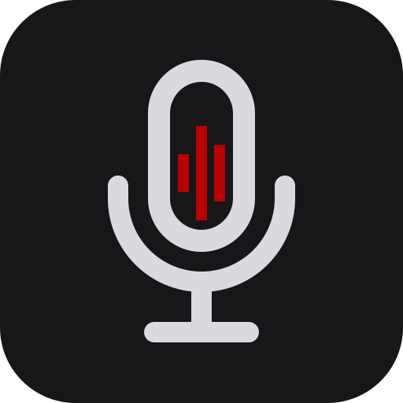

<p align="center"></p>

# Podcast-Monitor

A Rust desktop tool that turns Chilean podcast episodes into a report you can read instead of listening: what each show talked about and for how long, who was named, and verbatim quotes you can check by minute. Transcription runs locally with whisper.cpp.

Status: a Windows command-line tool. It transcribes an episode from its RSS feed, fixes names against a glossary, and summarizes the transcript with topics ranked by airtime, people ranked by mentions and quotes found in the transcript. The PDF report, the desktop window in Spanish and the macOS build come next. Scope is in `docs/PRD.md`, phases and open items in `ROADMAP.md`, measured findings in `docs/research/`.

## Build (Windows)

Needs Rust, Visual Studio with the C++ tools, Ninja and the Vulkan SDK. The wrapper sets up the build environment and a short target folder:

```
tools/build/cargo-windows.cmd build --release
```

## Use

```
podcast-monitor episodes <feed-url>
podcast-monitor run <feed-url> --model <ggml-model.bin> [--glossary <names.txt>] [--latest 1]
podcast-monitor summarize <transcript.json> [--glossary <names.txt>] [--provider <cli>]
```

- `episodes` lists the newest episodes of a feed.
- `run` downloads, transcribes and name-fixes the newest episodes into `work/runs`. Finished steps are kept, so running it again picks up where it stopped.
- `summarize` sends the transcript to an assistant CLI you are logged into, saves each part as it finishes, then prints the topics, people and quotes.

Every command takes `--help` for the rest of its options.

## Layout

- `src/`: the app.
- `tools/`: helper scripts (feed checks, transcription comparisons, the icon renderer, the build wrapper).
- `assets/brand/`: logo SVGs and the Windows (`.ico`) and macOS (`.icns`) icon sets.
- `monitor.py`: the original Python prototype, kept for reference only.
